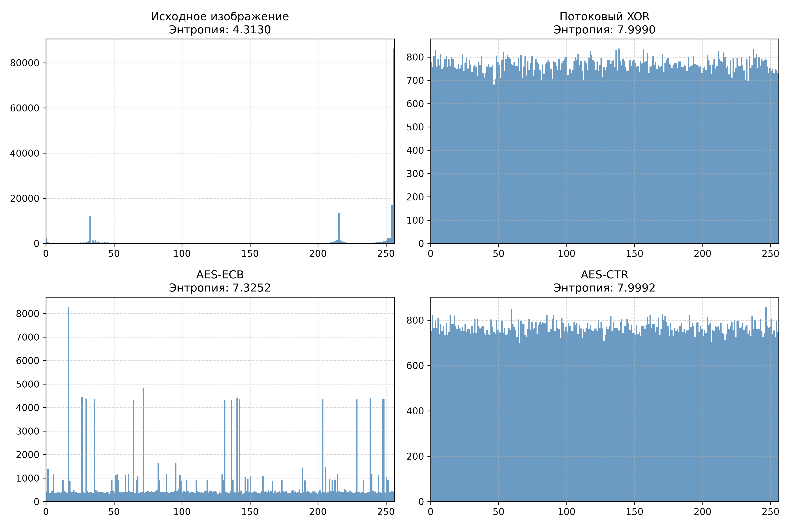
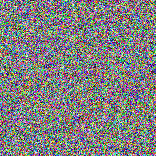
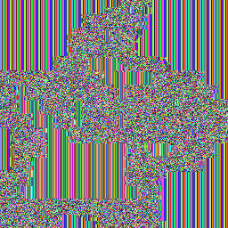
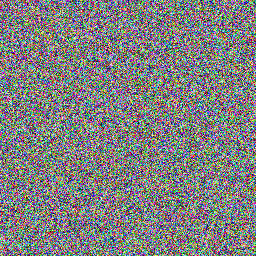

# Отчет

## Постановка задачи

Реализованные методы шифрования:

  * Потоковый шифр на базе генератора псевдослучайных чисел `xorshift32`
  * Блочный шифр `AES-ECB`
  * Блочный шифр `AES-CTR`
    
Используемые изображения: градиент(`gradient.png`), шахматная доска(`checkerboard.png`), тестовое изображение пикачу(`pikachu.png`).

Предмет сравнения:

  * Сохранение визуальной структуры и паттернов открытого текста в шифротексте
  * Информационная энтропия распределения байтов. Коэффициенты корреляции соседних пикселей по горизонтали и вертикали
  * Чувствительность алгоритма к изменению одного бита ключа
  * Строгая побайтовая обратимость преобразований

## Реализация

Первые 4 байта `SHA-256` хэша ключа задают 32-битное начальное состояние (`seed`), из которого генератор `XORShift32` формирует псевдослучайную гамму. В функции `xor_cipher` каждый байт изображения складывается по модулю 2 с байтом гаммы. Расшифрование выполняется этой же функцией благодаря симметричности операции XOR.

  ```bash

    def next_u32(self) -> int:
      x = self.state
      x = (x ^ (x << 13)) & 0xFFFFFFFF
      x = (x ^ (x >> 17)) & 0xFFFFFFFF
      x = (x ^ (x << 5)) & 0xFFFFFFFF
      self.state = x
      return x

    def xor_cipher(data: bytes, key: str | bytes) -> bytes:
        seed = derive_seed(key)
        keystream = XORShift32(seed).byte_stream()
        return bytes(b ^ next(keystream) for b in data)

   ```

Подготовливаем ключ и паддинг, а именно пароль через `SHA-256` приводится к 32 байтам ключа `AES-256`. Функции `pkcs7` дописывают недостающие байты до размера блока в 16 байт при зашифровании и удаляют их при расшифровании.

```bash

    def derive_key(key: str | bytes) -> bytes:
      if isinstance(key, str):
          key = key.encode("utf-8")
      return hashlib.sha256(key).digest()

    def pad_pkcs7(data: bytes, block_size: int = 16) -> bytes:
      padding_len = block_size - (len(data) % block_size)
      return data + bytes([padding_len] * padding_len)

   ```

В режиме `AES-ECB` массив пикселей разбивается на независимые 16-байтные блоки: некратные блоки дополняются паддингом `pkcs7`, после чего шифруются с 256-битным ключом `SHA-256`. При расшифровании блоки восстанавливаются в исходный порядок, а добавленный паддинг удаляется.

```bash

    def encrypt_ecb(data: bytes, key: str | bytes) -> bytes:
      aes_key = derive_key(key)
      if len(data) % 16 != 0:
          data = pad_pkcs7(data, block_size=16)
      cipher = Cipher(algorithms.AES(aes_key), modes.ECB())
      encryptor = cipher.encryptor()
      return encryptor.update(data) + encryptor.finalize()

    def decrypt_ecb(data: bytes, key: str | bytes) -> bytes:
      aes_key = derive_key(key)
      cipher = Cipher(algorithms.AES(aes_key), modes.ECB())
      decrypted = cipher.decryptor().update(data) + cipher.decryptor().finalize()
      try:
          return unpad_pkcs7(decrypted)
      except ValueError:
          return decrypted

   ```

`AES-CTR` превращает блочный шифр в потоковый. Шифруется случайная метка (nonce) со счётчиком, порождая гамму, которая складывается с пикселями через XOR без необходимости дополнения данных.

```bash

    def encrypt_ecb(data: bytes, key: str | bytes) -> bytes:
      aes_key = derive_key(key)
      if len(data) % 16 != 0:
          data = pad_pkcs7(data, block_size=16)
      cipher = Cipher(algorithms.AES(aes_key), modes.ECB())
      encryptor = cipher.encryptor()
      return encryptor.update(data) + encryptor.finalize()

    def decrypt_ecb(data: bytes, key: str | bytes) -> bytes:
      aes_key = derive_key(key)
      cipher = Cipher(algorithms.AES(aes_key), modes.ECB())
      decrypted = cipher.decryptor().update(data) + cipher.decryptor().finalize()
      try:
          return unpad_pkcs7(decrypted)
      except ValueError:
          return decrypted

   ```

Хранение IV / Nonce: 
  * Для режима `AES-CTR` случайный 16-байтный вектор инициализации генерируется криптостойким `os.urandom(16)`.
  * Вектор инициализации преобразуется в hex-строку и сохраняется в файле `meta.json` вместе с названием алгоритма и именем файла. При расшифровании функция `load_metadata` считывает `JSON` и конвертирует `hex` обратно в 16 байтов `nonce_bytes`.

```bash

  def save_metadata(filepath: str, algorithm: str, source_filename: str, nonce: bytes | None = None) -> None:
      meta = {"algorithm": algorithm, "source": source_filename}
      if nonce is not None:
          meta["nonce"] = nonce.hex()
      with open(filepath, "w", encoding="utf-8") as f:
          json.dump(meta, f, indent=2, ensure_ascii=False)

  def load_metadata(filepath: str) -> dict:
      with open(filepath, "r", encoding="utf-8") as f:
          data = json.load(f)
      if "nonce" in data and data["nonce"]:
          data["nonce_bytes"] = bytes.fromhex(data["nonce"])
      return data

   ```

Проверка обратимости (SHA-256): 

  * Для каждого метода исходный байтовый поток пикселей шифруется, затем расшифровывается.
  * До начала шифрования для массива пикселей рассчитывается контрольная сумма SHA-256.
    ```bash
      def compute_sha256(data: bytes) -> str:
      return hashlib.sha256(data).hexdigest()
       ```
    
  * Для каждого метода выполняется полный цикл «шифрование --> расшифрование», после чего сравниваются хэш-суммы и проверяется побайтовое равенство исходного и восстановленного массивов.

    ```bash
    
      enc_ctr_bytes, used_nonce = encrypt_ctr(raw_pixels, secret_key, nonce=nonce)
      dec_ctr_bytes = decrypt_ctr(enc_ctr_bytes, secret_key, nonce=used_nonce)
    
      record = {
        "method": "AES-CTR",
        "original_sha256": compute_sha256(raw_pixels),
        "restored_sha256": compute_sha256(dec_ctr_bytes),
        "exact_match": (raw_pixels == dec_ctr_bytes),
      }
    
       ```

## Методика эксперимента

Для изображения `pikachu` проводилось основное статистическое сравнение.

Оценивались:

  * Cтепень хаотичности и равномерности распределения значений байтов
  * Коэффициент корреляции, то есть оценивалась линейная зависимость между смежными пикселями по горизонтали и вертикали.
  * Метрики `NPCR` и `UACI`
  * Гистограммы распределения интенсивности

Для расчёта корреляции по горизонтали и вертикали использовалась случайная выборка до 50 000 пар соседних пикселей. Это ускоряет вычисления без потери статистической точности.

  ```bash
    
      #Извлечение первого цветового канала для цветного изображения
      if len(shape) == 3:
          corr_h, corr_v = compute_correlations(arr_2d[:, :, 0])
      
      #Формирование соседних пар и выборка до 50 000 элементов
      h_pairs_x = img_array[:, :-1].flatten()
      h_pairs_y = img_array[:, 1:].flatten()
      
      if len(h_pairs_x) > max_samples:
          indices = np.random.choice(len(h_pairs_x), max_samples, replace=False)
          corr_h = compute_correlation_pair(h_pairs_x[indices], h_pairs_y[indices])
    
   ```

Картинка шифровывается дважды через `AES-CTR` с одним вектором `nonce`, но разными ключами. Затем сравниваются результаты: `NPCR` считает процент изменившихся байтов, а `UACI` - среднюю разницу между ними.

  ```bash
    
        #Шифрование одного изображения двумя разными ключами с одинаковым nonce
        nonce = b"\x00" * 16
        c1, _ = encrypt_ctr(image_bytes, key1, nonce=nonce)
        c2, _ = encrypt_ctr(image_bytes, key2, nonce=nonce)
        
        #Расчет метрик NPCR и UACI
        a1 = np.frombuffer(c1, dtype=np.uint8).astype(np.float64)
        a2 = np.frombuffer(c2, dtype=np.uint8).astype(np.float64)
        
        npcr = float(np.mean(a1 != a2) * 100.0)
        uaci = float(np.mean(np.abs(a1 - a2) / 255.0) * 100.0)
    
  ```

## Результаты

Сводная таблица метрик

| № | Метод | Энтропия | Corr H | Corr V | Особенности | 
| :-: | :--- | :-: | :-: | :-: | :-: | 
| 1 | Исходное изображение | 4.313 | 0.8697 | 0.8248 | Само изображение | 
| 2 | Потоковый XOR | 7.999 | -0.0062 | 0.0033 | Цветовой шум | 
| 3 | AES-ECB | 7.362 | -0.0243 | 0.5109 | Цветовой шум, но видно очертания изображения | 
| 4 | AES-CTR | 7.9991 | 0.0067 | 0.0039 | Цветовой шум | 

Гистограмма исходного изображения, потокового `XOR`, `AES-ECB` и `AES-CTR`



Результаты проверки обратимости

  * Исходное изображение
    
    

  * `XOR`
    
    
    
  * `AES-ECB`
    
    
    
  * `AES-CTR`
    
    

`NPCR`/`UACI` для эксперимента с ключом с помощью `AES-CTR`

  * Добавляется к нашему ключу `_b` и получаем `NPCR` = 99.6048%, `UACI` = 33.4524%

## Анализ 

Исходное изображение отличается сильной линейной зависимостью между соседними пикселями и низкой энтропией, что типично для картинок с крупными областями одного цвета. Методы `AES-CTR` и потоковый `XOR` имеют энтропии, которые практически достигают теоретический максимум, а корреляция снизилась почти до нуля. Это полностью разрушает структуру изображения и превращает его в цветовой шум. Метод `AES-ECB`, наоборот, показал другие результаты: по горизонтали корреляция хоть и снизилась, но по вертикали сохранилась высокая зависимость, а энтропия составила всего 7.3, что далековато от 8. Разница между методами заключается в том что в `AES-ECB` каждый 16-байтный блок шифруется изолированно, из-за чего одинаковые участки фона превращаются в идентичные блоки шифра и сохраняют очертания рисунка. В методе `AES-CTR` такой проблемы нет, так как за счет счетчика и вектора `nonce` для каждого блока вырабатывается своя уникальная гамма, гарантирующая случайный результат. Все это можно увидеть на гистограмме:  у `AES-CTR` и `XOR` получилась абсолютно ровная практически сплошная линия равной частоты всех байтов, а на гистограмме `AES-ECB` хорошо видно повторяющиеся всплески.

## Вывод

Эксперимент показал, что подходы `AES-CTR` и потоковый `XOR` обеспечивают полноценную криптографическую защиту изображения, в то время как метод `AES-ECB` не пригоден для шифрования данных с высокой избыточностью из-за сохранения структуры оригинала.
