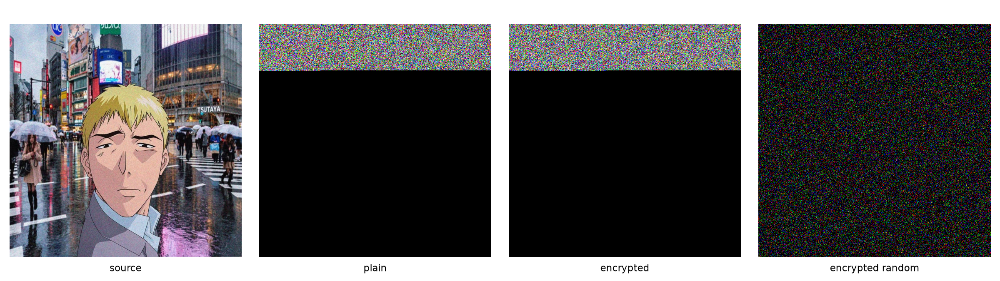
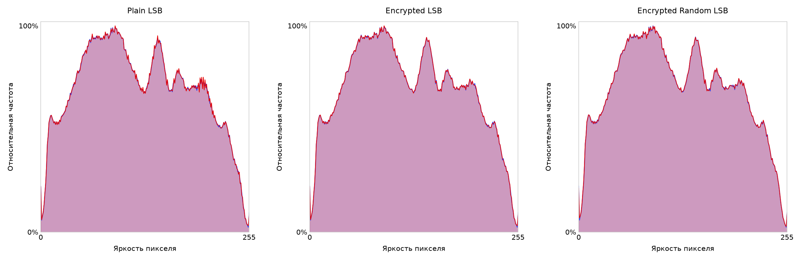

# Отчет

## 1. Постановка задачи

### Три варианта, которые сравнивались:

* `Plain LSB` - открытый текст напрямую записывается в младшие биты цветовых каналов подряд
* `Encrypted LSB` - исходное сообщение сначала зашифровывается алгоритмом `AES-256-GCM`, после чего шифротекст последовательно распределяется по пикселям
* `Encrypted Random LSB` - данные шифруются по стандарту `AES-256-GCM`, а их биты записываются в псевдослучайные позиции `RGB-компонент`, маршрут которых зависит от пароля

### Используемые изображения:

- `gradient.png` 
- `gto.png`
- `checkerboard.png`

### Встраивалось сообщение:
* Автоматически сформированное под заданную долю заполнения контейнера(в основном 10%)

## Реализация

## 2. Реализация

### 1. Как выполняется LSB-встраивание

  * Байтовый пакет данных преобразуется в одномерный массив битов (значений `0` и `1`) с помощью функции `np.unpackbits`. Каждый байт раскладывается на 8 бит от старшего к младшему.
  * Исходное изображение загружается через библиотеку `Pillow`, приводится к цветовой модели `RGB` (3 канала по 8 бит на каждый пиксель) и разворачивается в одномерный массив байтов `flat` 
  * Для каждой выбранной цветовой компоненты сначала обнуляется младший бит побитовой маской `0xFE`, а затем с помощью побитового ИЛИ (`|`) на его место записывается текущий бит сообщения
  * Модифицированный одномерный массив возвращается к исходной трёхмерной форме и сохраняется в формате `png` без сжатия с потерями

```python
      CLEAR_LSB_MASK = 0xFE  # Битовая маска для обнуления младшего бита
      
      def bytes_to_bits(data: bytes) -> np.ndarray:
          # Преобразование байтовой строки в одномерный массив битов
          byte_array = np.frombuffer(data, dtype=np.uint8)
          return np.unpackbits(byte_array)
      
      # Загрузка RGB-изображения и разворачивание каналов в одномерный массив
      img = Image.open(cover_path).convert("RGB")
      arr = np.array(img, dtype=np.uint8)
      flat = arr.ravel()
      
      # Запись битов в младшие разряды выбранных компонент
      flat[:total_bits] = (flat[:total_bits] & CLEAR_LSB_MASK) | bits
      
      # Восстановление формы и сохранение в PNG без потерь
      stego_arr = flat.reshape(arr.shape)
      Image.fromarray(stego_arr, mode="RGB").save(stego_path, format="PNG")
```

### 2. Как хранится длина сообщения

  * Длина сообщения в байтах упаковывается в `4-байтное (32-битное) беззнаковое целое число` в сетевом порядке байтов `big-endian` (`>I`) с помощью модуля `struct`. Это позволяет однозначно кодировать размер данных
  * Сформированный заголовок склеивается с полезными данными в единый байтовый поток: `[длина данных (4 байта = 32 бита)] || [сообщение (N байт)]`
  * Порядок считывания при извлечении:
     * Сначала из изображения считываются ровно первые `32 младших бита`
     * Извлечённые биты собираются в 4 байта (`np.packbits`) и распаковываются обратно в целое число, которое показывает точный размер скрытого блока в байтах
     * После этого вычисляется общее количество бит пакета, и считываются следующие `data_len * 8` младших бит

```python
      HEADER_SIZE_BYTES = 4    # Размер заголовка длины в байтах
      HEADER_SIZE_BITS = 32    # Размер заголовка длины в битах
      EXTRACT_LSB_MASK = 1     # Маска для чтения младшего бита
      
      # Встраивание
      # Добавляем 4-байтный заголовок длины (big-endian) перед сообщением
      payload = struct.pack(">I", len(data)) + data
      
      # Извлечение
      # Считывание первых 32 младших бит и преобразование их в 4 байта
      header_bits = flat[:HEADER_SIZE_BITS] & EXTRACT_LSB_MASK
      header_bytes = bits_to_bytes(header_bits)
      
      # Декодирование длины скрытых данных (в байтах)=
      (data_len,) = struct.unpack(">I", header_bytes)
      
      # Вычисление общей границы пакета в битах и извлекаем сообщение
      total_bits = HEADER_SIZE_BITS + data_len * 8
      data_bits = flat[HEADER_SIZE_BITS:total_bits] & EXTRACT_LSB_MASK
      extracted_data = bits_to_bytes(data_bits)
```

### 3. Как проверяется вместимость

  * При встраивании данных:
     * После добавления 4-байтного заголовка длины (и полей `salt`, `nonce`, `tag` в гибридных режимах) полный байтовый пакет переводится в массив битов, и определяется его итоговый размер `total_bits`
     * Исходное изображение приводится к формату `RGB` и разворачивается в одномерный массив `flat`, свойство `flat.size` которого возвращает полное число доступных бит
     * Сравниваются значения `total_bits` и `flat.size`: если требуемое количество бит превышает вместимость контейнера, операция прерывается с ошибкой, что предотвращает потерю данных или выход за границы массива

  * При извлечении данных:
     * Сначала проверяется, что изображение содержит как минимум 32 бита для чтения заголовка длины 
     * После распаковки длины вычисляется общий размер пакета и проверяется условие `total_bits > flat.size`. Это предовращает возможность попытки считать больше данных, чем физически помещается в картинку
       
```python
      HEADER_SIZE_BITS = 32
      
      # Проверка вместимости при встраивании
      payload = struct.pack(">I", len(data)) + data
      bits = bytes_to_bits(payload)
      total_bits = len(bits)  # Полное число бит с учётом 32-битного заголовка
      
      img = Image.open(cover_path).convert("RGB")
      arr = np.array(img, dtype=np.uint8)
      flat = arr.ravel()      # flat.size == width * height * 3 (доступная емкость в битах)
      
      if total_bits > flat.size:
          raise ValueError("Слишком большие данные")
      
      # Проверка границ при извлечении
      if flat.size < HEADER_SIZE_BITS:
          raise ValueError("Изображение слишком маленькое")
      
      # После чтения длины data_len из первых 32 бит проверяем, не выходит ли пакет за пределы файла
      total_bits = HEADER_SIZE_BITS + data_len * 8
      if total_bits > flat.size:
          raise ValueError("Некорректная длина в заголовке или неверный пароль.")
```

### 4. Как выполняется шифрование

В режимах `Encrypted LSB` и `Encrypted Random LSB` перед встраиванием в изображение сообщение защищается методом `AES-256-GCM`:
  * С помощью генератора `os.urandom()` создаются уникальная соль `salt` (16 байт) и вектор инициализации `nonce` (12 байт). Благодаря новой случайной соли и `nonce` при каждом запуске даже одинаковое сообщение с тем же паролем преобразуется в совершенно разный шифротекст
  * Текстовый пароль пользователя кодируется в `UTF-8` и пропускается через функцию формирования ключа `PBKDF2HMAC` с алгоритмом хеширования `SHA-256`. На выходе получается 32-байтный (256-битный) ключ шифрования. Большое число итераций защищает ключ от быстрого перебора по словарю.
  * Открытый текст переводится в байты `UTF-8` и шифруется `AESGCM(key)` с использованием сгенерированного `nonce`. Алгоритм шифрует данные в режиме счетчика и одновременно вычисляет 16-байтный тег аутентификации, который автоматически дописывается в конец шифротекста. При расшифровании этот тег гарантирует, что пароль введён верно, а пиксели контейнера не были повреждены.

```python
      SALT_SIZE = 16
      NONCE_SIZE = 12
      KEY_SIZE = 32
      GCM_TAG_SIZE = 16
      PBKDF2_ITERATIONS = 100_000
      
      def derive_key(password: str, salt: bytes) -> bytes:
          # Вывод 256-битного ключа из пароля и соли через PBKDF2-HMAC-SHA256
          kdf = PBKDF2HMAC(
              algorithm=hashes.SHA256(),
              length=KEY_SIZE,
              salt=salt,
              iterations=PBKDF2_ITERATIONS,
          )
          return kdf.derive(password.encode("utf-8"))
      
      def encrypt_message(message: str, password: str) -> bytes:
          # Генерация случайных соли и nonce
          salt = os.urandom(SALT_SIZE)
          nonce = os.urandom(NONCE_SIZE)
      
          # Получение ключа шифрования из пароля и соли
          key = derive_key(password, salt)
      
          # Шифрование текста (16-байтный тег целостности добавляется в конец автоматически)
          aesgcm = AESGCM(key)
          ciphertext = aesgcm.encrypt(
              nonce=nonce,
              data=message.encode("utf-8"),
              associated_data=None,
          )
      
          # Возвращаем единый байтовый пакет
          return salt + nonce + ciphertext
```

### 5. Какие служебные данные сохраняются

  * В режиме `Plain LSB`:
     * Длина сообщения (`length`, 4 байта): беззнаковое 32-битное целое число (`big-endian`), указывающее размер текста в байтах
     * Итоговый формат встраиваемого пакета:
          * `[length] || [UTF-8 текст]`

  * В гибридных режимах `Encrypted LSB` и `Encrypted Random LSB`:
     * Длина зашифрованного пакета (`length`, 4 байта): суммарный размер криптографического блока (`salt + nonce + ciphertext + tag`) в байтах
     * Соль (`salt`, 16 байт): случайное значение для `PBKDF2-HMAC-SHA256`
     * Вектор инициализации (`nonce`, 12 байт): одноразовое случайное число для инициализации счётчика в режиме `AES-GCM`
     * Тег аутентификации (`GCM tag`, 16 байт): контрольная сумма (тег целостности), которая автоматически добавляется в конец шифротекста при шифровании и позволяет при расшифровании проверить, что пароль введён верно, а пиксели изображения не были повреждены или изменены.
     * Итоговый формат встраиваемого пакета:
          * `[length] || [salt] || [nonce] || [ciphertext] || [GCM tag]`

```python
      SALT_SIZE = 16     # Случайная соль для PBKDF2
      NONCE_SIZE = 12    # Вектор инициализации для AES-GCM
      GCM_TAG_SIZE = 16  # Тег аутентификации
      
      # При шифровании склеивание соли, nonce и шифротекста с тегом в конце
      encrypted_blob = salt + nonce + ciphertext
      
      # При расшифровании отрезание служебных заголовков строго по их фиксированной длине
      salt = encrypted_blob[:SALT_SIZE]
      nonce = encrypted_blob[SALT_SIZE : SALT_SIZE + NONCE_SIZE]
      ciphertext = encrypted_blob[SALT_SIZE + NONCE_SIZE :]  
```

### 6. Как формируется псевдослучайный порядок позиций

В режиме `Encrypted Random LSB` биты сообщения записываются не подряд в верхнюю часть изображения, а распределяются равномерно по всей площади контейнера в псевдослучайном порядке, зависящем от пароля:

  * Получение `seed` из пароля:
     * Текстовый пароль кодируется в UTF-8, и от него вычисляется 32-байтный криптографический хеш `SHA-256`
     * Первые 8 байт полученного хеша преобразуются в 64-битное беззнаковое целое число `seed`.
  * Генерация перестановки без повторений:
     * На основе вычисленного `seed` инициализируется генератор псевдослучайных чисел `numpy.random.default_rng(seed)`
     * Метод `rng.permutation(total_elements)` перемешивает все доступные индексы цветовых компонент от `0` до `flat.size - 1`. Использование перестановки гарантирует, что ни одна компонента не будет перезаписана дважды
  * Выбор позиций и воспроизводимость при извлечении:
     * При встраивании из перемешанного массива берутся первые `total_bits` индексов, в которые записываются биты заголовка длины и зашифрованного пакета
     * При извлечении получатель вводит тот же пароль, генератор `default_rng(seed)` формирует точно такую же последовательность индексов, что позволяет считать первые 32 бита длины, а затем остальные биты сообщения

```python
      def get_permutation_indices(total_elements: int, password: str) -> np.ndarray:
          # Вычисление SHA-256 пароля
          digest = hashlib.sha256(password.encode("utf-8")).digest()
          seed = int.from_bytes(digest[:8], byteorder="big", signed=False)
          # Перемешивание всех индексов [0, total_elements) без повторений
          rng = np.random.default_rng(seed)
          return rng.permutation(total_elements)
```

```python      
      indices = get_permutation_indices(flat.size, password)
      
      # При встраивании берем первые total_bits уникальных случайных позиций
      target_indices = indices[:total_bits]
      flat[target_indices] = (flat[target_indices] & CLEAR_LSB_MASK) | bits
      
      # При извлечении чтение заголовка из первых 32 случайных позиций, а данные из следующих
      header_bits = flat[indices[:HEADER_SIZE_BITS]] & EXTRACT_LSB_MASK
      encrypted_bits = flat[indices[HEADER_SIZE_BITS:total_bits]] & EXTRACT_LSB_MASK
```

## Методика эксперимента

### 1. Объём встраиваемых данных и уровни заполнения (payload)
Максимальная теоретическая емкость контейнера в битах определяется общим числом цветовых компонент RGB-изображения, поскольку в каждый канал записывается 1 младший бит. При расчете полезной нагрузки учитывался резерв под служебные заголовки 

В ходе исследования сравнивались два уровня заполнения контейнера:
  * 1% от вместимости (малая нагрузка) - моделирует передачу коротких текстовых сообщений или криптографических ключей
  * 10% от вместимости (основной эксперимент) - базовый уровень заполнения, на котором проводится сопоставление всех трёх методов, визуализация карт разности и проверка чувствительности статистических тестов

Сообщение формировалось автоматически под требуемый процент заполнения, а для корректности сравнения на каждом уровне во все три алгоритма передавалось одно и то же сообщение.

### 2. Исследуемые изображения
  * `gto.png` 
  * `gradient.png`

### 3. Рассчитываемые метрики
Для каждого полученного stego-изображения вычислялся набор визуальных и статистических показателей:
  * PSNR - пиковое отношение сигнал/шум, оценивающее уровень вносимых искажений относительно исходного изображения
  * SSIM - индекс структурного сходства, измеряющий сохранение структуры, яркости и контраста изображения в диапазоне от 0 до 1
  * Доля изменённых компонент - фактическая доля изменённых цветовых компонент (LSB) по отношению к их общему количеству в изображении
  * Распределение LSB - процентное соотношение бит `0` и `1` в младшем разряде всех каналов контейнера до и после встраивания
  * χ²-анализ - статистический тест стегоанализа, проверяющий равномерность распределения пар соседних значений яркости (2k, 2k+1) в младших битах
  * Карты разности - попиксельная разница между исходным и модифицированным изображениями
  * Гистограммы распределения LSB

## Результаты

## 4. Результаты

### 1. Сводная таблица метрик для `gto.png` (заполнение 10%)

Всего цветовых компонент: `1 627 290`. Объём сообщения: 20293 байт (с заголовками: 20341 / 203411 байт)

| Вариант | PSNR | SSIM | Изменено компонент | Changed ratio | P(LSB=0) | P(LSB=1) | χ² | p-value |
|---|---:|---:|---:|---:|---:|---:|---:|---:|
| **Cover** | — | — | 0 | 0% | 0.500330 | 0.499670 | 1837.0478 | 0.000000 |
| **Plain LSB** | 61.1485 | 0.999832 | 81 226 | 4.99% | 0.496203 | 0.503797 | 1673.2780 | 0.000000 |
| **Encrypted LSB** | 61.1340 | 0.999828 | 81 497 | 5.01% | 0.500403 | 0.499597 | 1547.3586 | 0.000000 |
| **Encrypted Random LSB** | 61.1361 | 0.999857 | 81 459 | 5.01% | 0.500440 | 0.499560 | 1509.9316 | 0.000000 |

### 2. Сводная таблица метрик для `gradient.png` (заполнение 10%)

Всего цветовых компонент: `786 432`. Объём сообщения: 9782 байт (с заголовками: 9830 / 98304 байт)

| Вариант | PSNR | SSIM | Changed ratio | P(LSB=0) | P(LSB=1) | χ² | p-value |
|---|---:|---:|---:|---:|---:|---:|---:|
| **Cover** | — | — | 0.00% | 0.537793 | 0.462207 | 52106.7563 | 0.000000 |
| **Plain LSB** | 61.2438 | 0.998760 | 4.88% | 0.522640 | 0.477360 | 29864.7935 | 0.000000 |
| **Encrypted LSB** | 61.1412 | 0.998636 | 5.00% | 0.526920 | 0.473080 | 27354.9767 | 0.000000 |
| **Encrypted Random LSB** | 61.1349 | 0.999158 | 5.01% | 0.534348 | 0.465652 | 41887.6359 | 0.000000 |

### 3. Сравнение результатов для двух уровней payload (`1%` и `10%`, `gto.png`)

| Payload | Вариант | PSNR | Changed ratio | χ² | p-value |
|---:|---|---:|---:|---:|---:|
| **1%** | Plain LSB | 71.2243 | 0.004905 | 1778.69 | 0.000000 |
| **1%** | Encrypted LSB | 71.1158 | 0.005029 | 1770.08 | 0.000000 |
| **1%** | Encrypted Random LSB | 71.1200 | 0.005024 | 1821.08 | 0.000000 |
| **10%** | Plain LSB | 61.1485 | 0.049915 | 1673.28 | 0.000000 |
| **10%** | Encrypted LSB | 61.1340 | 0.050081 | 1547.36 | 0.000000 |
| **10%** | Encrypted Random LSB | 61.1361 | 0.050058 | 1509.93 | 0.000000 |

### 4. Сравнение изображений разного типа (`gto.png`(текстурное изображение) и `gradient.png`(синтетическое изображение), заполнение 10%)

| Изображение (тип) | Вариант | PSNR | SSIM | Changed ratio | Смещение `P(LSB=1)` от Cover | Изменение χ² от Cover |
|---|---|---:|---:|---:|---:|---:|
| **`gto.png`** | Plain LSB | 61.1485 | 0.999832 | 4.99% | +0.004127 | −8.9% |
| **`gto.png`** | Encrypted LSB | 61.1340 | 0.999828 | 5.01% | −0.000073 | −15.8% |
| **`gto.png`** | Encrypted Random LSB | 61.1361 | 0.999857 | 5.01% | −0.000110 | −17.8% |
| **`gradient.png`** | Plain LSB | 61.2438 | 0.998760 | 4.88% | +0.015153 | −42.7% |
| **`gradient.png`** | Encrypted LSB | 61.1412 | 0.998636 | 5.00% | +0.010873 | −47.5% |
| **`gradient.png`** | Encrypted Random LSB | 61.1349 | 0.999158 | 5.01% | +0.003446 | −19.6% |

### 3. Карта разности



### 4. Сравнительная гистограмма распределения младших битов



## Анализ

При одинаковом уровне заполнения 10% на основном изображении `gto.png` все три метода обеспечивают практически одинаковое и высокое визуальное качество: `PSNR` находится в узком диапазоне `61.13–61.15 дБ`, а `SSIM` составляет `0.999828–0.999857`, что исключает визуальное обнаружение изменений. Небольшое преимущество по `SSIM` у `Encrypted Random LSB` (`0.999857` на `gto.png` и `0.999158` на `gradient.png` против `0.998636–0.998760` у других методов) объясняется тем, что мелкие изменения ±1 разбросаны по всей картинке, а не собраны в одном месте.

Доля реально изменённых компонент подтверждает теоретическую модель LSB-встраивания: поскольку записываемый бит примерно в половине случаев совпадает с уже имеющимся младшим битом канала, при заполнении 10% емкости меняется около **5.00%** компонент (`0.049915–0.050081` на `gto.png`), а при заполнении 1% - около **0.5%** (`0.004905–0.005029`). На изображении `gradient.png` у `Plain LSB` доля изменений немного ниже (`4.88%`, `PSNR = 61.24 дБ`), так как в верхних строках градиента преобладают единицы в младших битах, а в `base_phrase = "hrumki"` на каждые 48 бит приходится 26 единиц и 22 нуля.

Тот же перекос в распределении бит открытого текста напрямую виден по метрикам `P(LSB=0) / P(LSB=1)`. На `gto.png` в исходном контейнере доли практически равны (`50.03% / 49.97%`), после `Plain LSB` доля единиц смещается вверх до `50.38%`, тогда как шифрование `AES-256-GCM` превращает полезную нагрузку в статистически равномерный поток бит и возвращает баланс в `Encrypted LSB` (`49.96%`) и `Encrypted Random LSB` (`49.96%`) практически к значениям оригинала. На `gradient.png`, где исходный баланс смещён (`53.78% / 46.22%`), последовательные методы меняют распределение заметнее (`P(LSB=1)` растёт до `47.74%` и `47.31%`), а случайное размещение сохраняет его значительно ближе к исходному (`46.57%`).

Сравнение двух типов изображений хорошо показывается в χ²-анализе. На `gto.png` исходная статистика χ² составляет `1837.05` и при 10% заполнения умеренно снижается до `1673.28` (`Plain LSB`), `1547.36` (`Encrypted LSB`) и `1509.93` (`Encrypted Random LSB`), при этом `p-value` по всему кадру остаётся равным `0.000000`, так как 90% компонент контейнера не затрагивались. На синтетическом `gradient.png` исходная структура пар `(2k, 2k+1)` крайне неравномерна (`χ² = 52106.76`): последовательное встраивание в верхнюю часть кадра выравнивает соседние оттенки в однородной зоне и почти вдвое обрушивает χ² (до `29864.79` в `Plain LSB` и `27354.98` в `Encrypted LSB`), тогда как `Encrypted Random LSB` распределяет изменения по разным областям градиента и снижает χ² всего на `19.6%` (`41887.64`).

Таким образом, шифрование защищает конфиденциальность и целостность сообщения (благодаря `AES-256-GCM`) и устраняет битовый перекос открытого текста, но само по себе не скрывает локализацию данных: на карте разности видно, что `Plain LSB` и `Encrypted LSB` образуют сплошную полосу в верхней части кадра. Добавление псевдослучайной перестановки (`Encrypted Random LSB`) устраняет эту границу, повышает `SSIM` и существенно снижает статистические аномалии на изображениях со структурированным фоном вроде `gradient.png`.

Увеличение объёма встраиваемых данных в 10 раз (с 1% до 10%) на `gto.png` пропорционально увеличивает `Changed ratio` с `0.5%` до `5.00%` и снижает `PSNR` ровно на 10 дБ (с `71.1–71.2 дБ` до `61.1 дБ`) для всех трёх методов. При нагрузке 1% значения χ² (`1770.08–1821.08`) практически не отличаются от оригинала (`1837.05`), а при 10% снижение χ² становится отчетливым, подтверждая прямую зависимость между объёмом встроенных данных и статистической заметностью.


## Вывод

В ходе экспериментального сравнения трёх подходов были получены следующие основные результаты:

1. При одинаковой нагрузке (1% и 10%) все три варианта обеспечивают практически идентичное и очень высокое визуальное качество. Ни шифрование, ни случайное размещение битов не делают искажения заметными для человеческого глаза.
2. Статистические различия в распределении бит и χ²-тесте:
  - `Plain LSB` оставляет сообщение незащищённым и из-за особенностей кодировки текста смещает баланс младших битов контейнера в сторону единиц, хотя на текстурном изображении общая статистика χ² при этом меняется незначительно.
  - `Encrypted LSB` и `Encrypted Random LSB` благодаря шифрованию `AES-256-GCM` возвращают соотношение нулей и единиц к естественному балансу оригинала, но при больших объёмах нагрузки сильнее выравнивают пары соседних оттенков, из-за чего статистика χ² снижается заметнее.
3. Сравнение изображений разного типа (`gto.png` и `gradient.png`) показало, что синтетические изображения с плавными переходами гораздо чувствительнее к стеганографии: последовательное встраивание почти вдвое снижает статистику χ² на `gradient.png` (42.7−47.5%), тогда как `Encrypted Random LSB` рассеивает модификации по всему кадру, сохраняя более высокий `SSIM` и ограничивая падение χ² на уровне -19.6%.
4. Методы `Plain LSB` и `Encrypted LSB` записывают данные сплошной полосой в верхней части изображения. Режим `Encrypted Random LSB` равномерно рассеивает изменения по всей площади кадра и привязывает порядок чтения битов к паролю, обеспечивая наилучший баланс.
